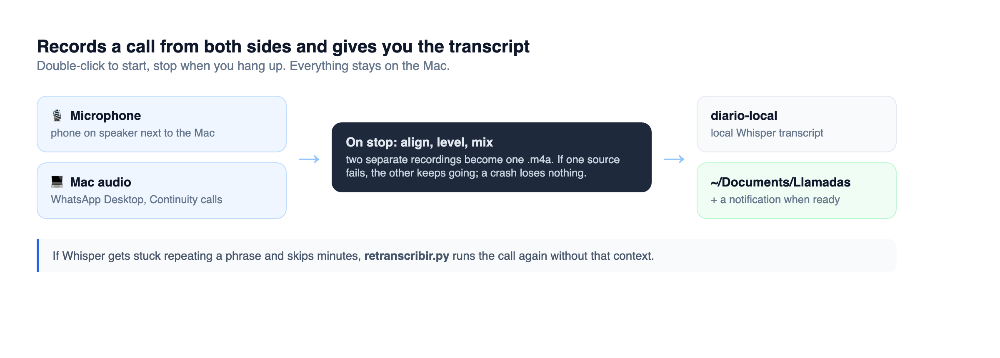

<div align="center">


# 📞 Grabar Llamada

### A Mac app that records a call from both sides and gives you a local transcript. Double-click to start, stop when you hang up.

[](#run-it)
[](#run-it)
[](https://github.com/diego-salomon/diario-local)
[](LICENSE)

<br>



</div>

---

The text lands in `~/Documents/Llamadas`.

It records the microphone (phone on speaker next to the Mac) and the Mac's own audio (WhatsApp Desktop, Continuity calls) as two separate files. If one source fails, the other keeps going, and a crash loses nothing: the next launch finishes the recording. On stop it aligns, levels and mixes both into one `.m4a`, hands it to [diario-local](https://github.com/diego-salomon/diario-local) for a local Whisper transcript, and notifies you when it's ready.

If Whisper gets stuck repeating a phrase and skips minutes, `herramientas/retranscribir.py` runs the call again without that context.

## Run it

macOS 15 on Apple Silicon, Xcode command line tools (`xcode-select --install`), and diario-local running.

```bash
./build.sh   # compiles, makes the icon, signs locally, installs to /Applications
```

macOS asks for microphone, system audio and Documents access the first time, and again after each rebuild. Folders are set at the top of `Llamada.swift`.

Code comments are in Spanish.

---

<div align="center">
<sub>Built by <a href="https://github.com/diego-salomon">Diego Salomón</a>. · <a href="https://www.linkedin.com/in/diegosalomon">LinkedIn</a></sub>
</div>
